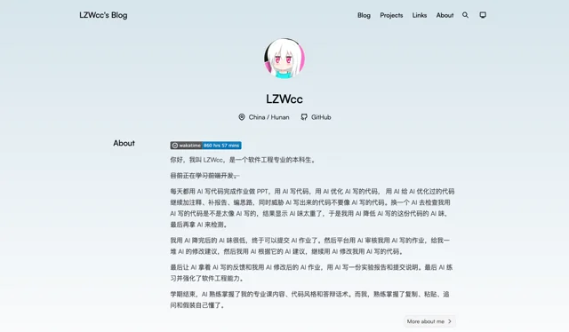
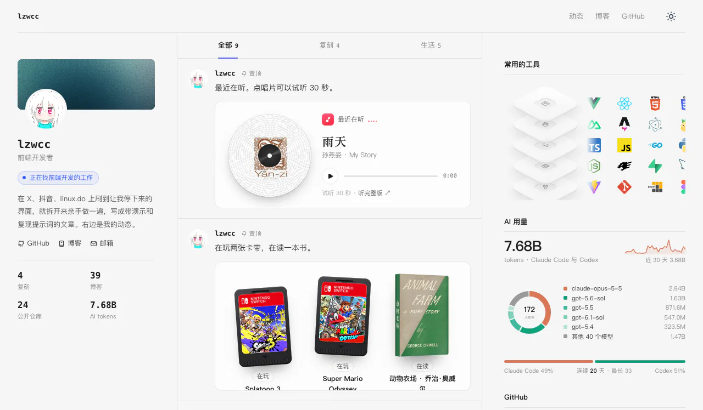
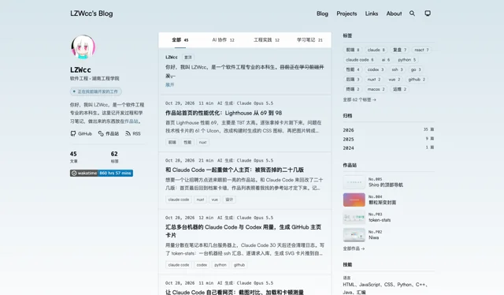
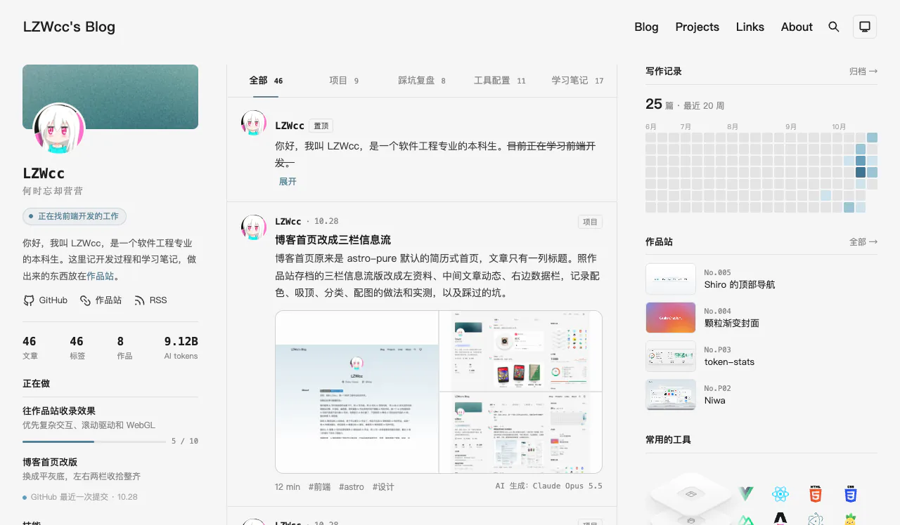

博客首页原来是 astro-pure 主题默认的简历式首页：头像居中，下面一大段 About，然后是最近 10 篇文章的标题和日期，再往下是教育、技能和一句随机名言。文章是博客的主体，在首页上却排在一大段自我介绍后面，而且只有标题。它和作品站 [ui-motion-lab](https://lab.lzwcc.xyz/) 的风格也完全是两套，从作品站点过来像换了一个人的网站。



## 三栏版的来历

改作品站首页时做过一版像推特的三栏信息流：左边个人资料，中间动态，右边工具、AI 用量和 GitHub。我很喜欢，但作品站最后用了档案卡墙，这一版存档成标签 `homepage-feed-v1`，当时就定下以后给博客首页用。经过写在[和 Claude Code 一起重做个人主页](/blog/personal-homepage-redesign/)里。



## 第一版没有采用

第一次改的时候只照搬了三栏的骨架：颜色用博客主题自己的变量，想着和文章页一致；右栏放标签、归档和作品站的作品，不放图表，想着不和作品站重复；中间是纯文字的文章卡片。做出来我看了觉得完全没有之前那种感觉。



对比下来，丢掉的正是三栏版的味道：浅灰底和白卡片的配色、左栏的颗粒渐变横幅、中间带头像和「LZWcc · 日期」的动态、右栏的技术栈和图表。之后改成在分支上做一个单独的草稿页，首页本身不动，我在浏览器里点过、提了意见再改，定下来才替换首页。

## 定稿



左栏是颗粒渐变横幅（用作品站的颗粒封面生成器导出成静态图）、资料、链接和几个数字，下面是原首页的教育卡片和技能；教育卡片用回主题原来的 `Card` 组件，悬浮时边框加深、出阴影。中间最上面置顶原首页 About 里那段话，默认只露第一句；每篇文章是一条动态，带头像、日期、分类、标题、摘要，有本地配图的带上配图。右栏从上到下是写作记录（每周写了几篇的热力图）、作品站最新的 4 件作品、常用的工具、AI 用量和 GitHub。原首页的随机名言放在页脚上面。

右栏后面三块和作品站首页是同一份数据：作品站静态导出时生成一个 `/home.json`，里面有作品列表、AI 用量、GitHub 贡献和技术栈的 SVG，博客构建时去读，5 秒内读不到就用仓库里的快照。

## 配色

配色用作品站的中性灰白（底色、卡片、线条、文字），强调色换回博客原来的青蓝，页面顶部也留着博客原来那层淡蓝渐变。文章页还是博客主题的颜色，首页如果用作品站的亮蓝，点进文章时颜色会跳一下；两个站的强调色不同，在两站之间来回点时也分得清在哪个站。

做的时候让页面带一个 `?palette=lab` 参数切回作品站原来的亮蓝，两套放在一起比过才定下来，上线前删掉了。

## 顶栏和两侧栏

顶栏用回博客主题原来的那个：在顶部时透明，往下滚变成浮动的圆角卡片，再往下滚藏起来，往上滚又出来。它的颜色都来自主题的 HSL 变量，在这一页把 `--background`、`--border`、`--primary` 这几个换成同一套配色，顶栏和页脚就跟着变了，动画不用动。分类栏和左栏吸顶的位置跟着顶栏走：顶栏露出来时停在它下面，藏起来时收到最上面（`:has(header-component[data-show='false'])`）。

右栏有将近 950px 高，比屏幕高。直接吸顶的话，下面几块永远看不到；不吸顶的话，滚到中间右边就是一大段空白。照推特的做法：比屏幕矮的栏停在顶栏下面，比屏幕高的栏先跟着页面滚，底部露出来以后停住。一小段脚本用 `ResizeObserver` 把栏的高度写进 CSS 变量，停的位置用 `min()` 算。`--head` 是顶栏露出来时占的高度，顶栏藏起来时是 0：

```css
.profile,
.rail {
  position: sticky;
  top: min(calc(var(--head) + 16px), calc(100vh - var(--h, 0px) - 16px));
  transition: top 0.3s;
}
```

```js
const asides = document.querySelectorAll('.profile, .rail')
const measure = () => asides.forEach((el) => el.style.setProperty('--h', `${el.offsetHeight}px`))
const resize = new ResizeObserver(measure)
asides.forEach((el) => resize.observe(el))
```

左栏后来加了教育和技能，也比屏幕高了，用的是同一条规则。

分类栏原来衬着一层半透明的浅灰，放在顶部的淡蓝渐变上像一块发白的长条。改成在原位时透明，吸顶以后文章从下面滚过才加底色和模糊。

## 分类

第一版按标签分成 AI 协作、工程实践、学习笔记，发现分不开：现在的文章几乎都是和 AI 一起做的，学习笔记按发布日期判断又把 10 月的课程作业分错了。改成在 frontmatter 里写 `category`，按文章写的是什么分：项目、踩坑复盘、工具配置、学习笔记，44 篇逐篇归了类。AI 参与了多少交给署名（手写、AI 协助、AI 生成），显示在每条动态右下角。选中的分类写进地址 `?cat=`，刷新和分享链接都还在这一类。

## 配图和摘要

摘要在首页最多显示 3 行，多的用省略号截掉，完整的在文章页和搜索结果里。改之前手机上有 18 篇要占 4 到 6 行。

配图先照推特做：1 张整宽，2 张并排，3 张一大两小，4 张田字格，每张裁成填满格子。性能优化那篇的两张 Lighthouse 截图又宽又扁，裁完 69 分和 TBT 都看不到了。博客的图多是截图和示意图，裁掉就看不懂，所以改成都不裁：全是宽图（宽 ≥ 高 × 1.8）时上下叠放、按原比例显示，最多 2 张；其他照推特的格子排，每张完整缩放进格子；放不下的在最后一张上标 +N。

## 性能和 SEO

在 Mac 上不带扩展的无头 Edge 里测生产构建（手机视口、CPU 降速 4 倍、禁用缓存），新首页 HTML 压缩后 43KB，原来是 10KB，TBT 0–50ms，原来是 0。文章列表在 HTML 里只占 7KB，全部渲染和只渲染前 10 篇比，TBT 只差 10–30ms，现在不值得用 JS 分批加载，而且没加载的文章搜索引擎和 Ctrl+F 都找不到。改成给每条动态加 `content-visibility: auto`：文章都在 HTML 里，屏幕外的浏览器先不排版、不绘制。加上以后 4 轮里 3 轮 TBT 是 0–6ms。往下翻时新进屏幕的文章浮上来，只动透明度和位移，首屏和减弱动效时不动。

改版前把所有页面的 title、description、canonical、og 标签和 sitemap、RSS 的 guid 存了一份，合并后完整构建再比，全部一致。首页现在直接链到全部文章，原来只链最近 10 篇。

## 踩过的坑

| 现象 | 原因 | 解决 |
|---|---|---|
| 深浅色按钮和分类切换都没反应 | 页面 `<script>` 里 `import { setTheme } from 'astro-pure/utils'`，它连带引入的 `date.ts` 依赖 `virtual:config`，浏览器端打包失败，整段脚本没有运行 | 不从 `astro-pure/utils` 引入，切换逻辑照 `setTheme` 自己写：存 `localStorage.theme`、切 `.dark`、改 `theme-color` |
| 点分类后选中的样式变了，文章一篇没少 | 用 `hidden` 隐藏文章，但 `.post { display: grid }` 盖过了 `[hidden]` 默认的 `display: none` | 加 `.post[hidden] { display: none }`；测的时候数页面上看得见的元素，不要只看 `hidden` 属性 |
| 主题顶栏不吸顶，往下滚直接滚出屏幕 | 顶栏外面包了一层和它一样高的 `div`，sticky 只在父元素范围内停住 | 顶栏和三栏放进同一个够高的容器 |
