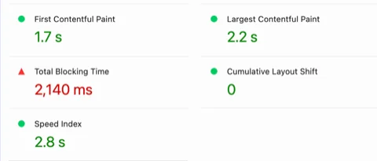

[ui-motion-lab](https://lab.lzwcc.xyz/) 是我的作品站，Nuxt 4 加 Nuxt UI，静态导出。首页用 Lighthouse 跑出来性能是 69，FCP、LCP、CLS 都还可以，红的只有 Total Blocking Time，2140ms，也就是首次加载时主线程被长任务占住的时间。改完以后在无痕窗口里重新跑是 98。




测量用的是我给 Claude Code 写的一套 CDP 脚本，用法写在[让 Claude Code 自己看网页](/blog/browser-check-skill/)。

## 测量方法

那次的报告顶上提示有浏览器扩展影响了加载，「未使用 JS 1118 KiB」这一项也对不上，首页的 JS 实际只传了 250KB 左右，所以后面都改在 Mac 上不带扩展的无头 Edge 里测：视口 412 宽，CPU 降速 4 倍，禁用缓存，抓 8 秒的 trace，把每个任务超过 50ms 的部分加起来当作 TBT。这样测出来首页是 500–700ms，跟 Lighthouse 的数不一样，所以只用来比较改动前后，两个版本交替着跑。

## 定位

CPU 采样里最长的那个任务是 Vue 的水合，耗时的函数分散在 Vue、@nuxt/icon 和 Nuxt UI 里，看不出是哪个组件。我先猜了三个，在导出的源码副本里各改一处再构建（一次 20 秒左右）去测：

| 改动 | 最长任务 |
|---|---|
| 不改 | 515–661ms |
| 提交记录热力图的 368 个格子不渲染 | 534–592ms |
| 像素头像换成空 div | 543–639ms |
| 图标换成 @nuxt/icon 的 SVG 模式 | 719–765ms |

都没有变好，SVG 模式还更慢了。后来改成一批一批地拿掉卡片：全部拿掉时最长任务是 186–244ms，这部分是全站都有的，文章页也是 200ms 左右；只拿掉下面两组横滑的 6 张卡片时是 257–302ms；再一张张拿，只有拿掉「技术栈」那张时降得明显，到了 313–349ms。

技术栈卡片里有 61 个 `UIcon`，5 个层级图标，加上 28 个 logo 各放了两遍，因为横向循环滚动要首尾接上。只把 logo 换成普通的 `<span>`，最长任务就到了 334–476ms。

Nuxt UI 的 `UIcon` 在浏览器里是 `UIcon`、`Icon`、`NuxtIconCss` 三层组件，每层都有 computed 或 watch，61 个图标水合的时候就有将近 200 个组件实例。另外第一个图标出现时，`NuxtIconCss` 会把页面上所有样式表的规则遍历一遍，看图标的样式在不在，浏览器得为整份 Tailwind CSS 建出 CSSOM，降速 4 倍的采样里这一段有几十毫秒。而图标的 CSS 在服务端渲染时已经内联在 HTML 里了，首页有一段 71KB 的 `<style>`。

## 图标改成 CSS 类

装了 Iconify 的 Tailwind 4 插件，主 CSS 里加一行：

```css
@import "tailwindcss";
@import "@nuxt/ui";
@plugin "@iconify/tailwind4";
```

模板里直接写类名，Tailwind 扫描源码时只给用到的图标生成 CSS，单色图标用 mask，会跟着文字颜色，彩色 logo 用背景图：

```vue
<!-- 之前 -->
<UIcon name="i-mingcute-github-line" />
<!-- 之后 -->
<span class="icon-[mingcute--github-line]" />
```

类名要完整地写在源码里，动态切换的时候写成两个完整的字符串，数据里也存完整的类名：

```vue
<span :class="playing ? 'icon-[mingcute--pause-fill]' : 'icon-[mingcute--play-fill]'" />
```

首页、页头页脚、文章页和作品列表里的图标都换了，收录的演示组件没换，还用 `UIcon`，搬到别的项目里方便。换完截了 8 组图逐像素对比，图标都一样，非正方形 logo 的宽度、深色模式下的月亮图标也没问题。交替测了三轮，TBT 从 515–665ms 到了 191–377ms，最长任务从 515–661ms 到了 180–247ms。

图标的 CSS 从首页 HTML 挪进了全站共用的 entry CSS，首页 HTML 压缩后从 39KB 变成 16KB，entry CSS 从 30KB 变成 55KB，多出来的里面有 21KB 是只有首页用到的彩色 logo，文章页第一次打开时也要下载。

## 图片转 WebP

封面、照片和项目截图原来都是 JPG，用 `cwebp -q 80 -m 6 -sharp_yuv` 转了 29 张，从 1646KB 变成 486KB。首页的图片（手机宽度，滚到底、横滑也看过）从 389KB 变成 196KB，一个项目页从 559KB 变成 153KB。

颗粒渐变那两张封面没转，它上面有一层很细的噪点，q80 转完噪点没了，q90 也丢了一部分，q95 能留住，可是有 72KB，跟 JPG 一样大。
浅色和深色封面按文件名配对（`xxx.webp` 和 `xxx-dark.webp`），换深色图的函数原来只认 `.jpg`，改成了 `/\.(webp|jpg)$/`。

## 缓存头

网站在 nginx 上，原来只有 `/_nuxt/` 设了一年的 `immutable`（文件名里有内容哈希），图片和 HTML 都没有 `Cache-Control`。图片加了 7 天，图片文件名不带哈希，设太长的话换了同名图片，老访客要很久才能看到。

HTML 加了 `no-cache`，浏览器每次用之前会先问一下服务器，没变就回 304。之前没有 `Cache-Control` 时，浏览器会按 `Last-Modified` 自己估一个缓存时间，我发布用的是 `rsync --delete`，旧的 `/_nuxt/` 文件会被删掉，有人拿着缓存里的旧 HTML 去请求那些 JS 和 CSS，页面就坏了。配置在附录里。

## 踩过的坑

| 现象 | 原因 | 解决 |
|---|---|---|
| 本地切换两个构建版本对比时，新版本整页没有样式 | 本地用 `python3 -m http.server` 托管，它带 `Last-Modified`，浏览器按启发式规则缓存了旧版本的 HTML，里面引用的 CSS 在新版本里不存在 | 对比截图和测量时禁用缓存（CDP 的 `Network.setCacheDisabled`） |
| 同一个目录第二次 `nuxt generate`，`/`、`/200.html`、`/404.html` 预渲染报 500，没有具体错误 | 上一次构建留下的 `.data`、`.nuxt` 有影响，具体原因没细查 | 每次构建前 `rm -rf .data .nuxt .output` |
| `pnpm add` 报 `Cannot find module …/corepack/v1/pnpm/12.11.2/bin/pnpm.cjs` | corepack 的缓存被清掉了 | 用和装 node_modules 时同一个版本的 pnpm（`node_modules/.modules.yaml` 里有写，这里是 11.9.0），别换大版本 |
| 图片转 WebP 后颗粒封面变光滑了 | 有损压缩把高频的噪点当细节去掉了 | 噪点类的图转完放大对比，保不住就留原格式 |

## 附录

nginx（`server` 块里，`location /_nuxt/` 之后）：

```nginx
location /images/ {
    add_header Cache-Control "public, max-age=604800";
    try_files $uri =404;
}
location /demos/ {
    add_header Cache-Control "public, max-age=604800";
    try_files $uri $uri/index.html =404;
}
location / {
    add_header Cache-Control "no-cache";
    try_files $uri $uri/index.html =404;
}
```

检查：

```sh
curl -sI https://lab.lzwcc.xyz/ | grep -i cache-control                   # no-cache
curl -sI https://lab.lzwcc.xyz/images/covers/niwa.webp | grep -i cache    # max-age=604800
```

二分时每一组的做法：从仓库导出一份源码到临时目录（`git archive HEAD | tar -x -C /tmp/x`，`node_modules` 用软链接），在副本里改一处，`rm -rf .data .nuxt .output && nuxt generate`，把 `.output/public` 拷成一个版本目录，本地静态托管后用 trace 测。仓库本身不动。

各组的完整数据（最长任务，每组 3～4 次，CPU 降速 4 倍、412 宽、禁用缓存）：

| 改动 | 最长任务 |
|---|---|
| 基线（这一组测得早，和正文表格里交替测的 515–661ms 不是同一时段） | 422–574ms |
| 拿掉首页全部卡片 | 186–244ms |
| 只拿掉两组横滑（6 张） | 257–302ms |
| 去掉背景那层代码文字 | 337–571ms |
| 单独拿掉 AI 用量卡 | 471–534ms |
| 单独拿掉提交记录卡 | 354–504ms |
| 单独拿掉技术栈卡 | 313–349ms |
| 单独拿掉音乐卡 | 537–596ms |
| 单独拿掉在玩卡 | 511–575ms |
| 单独拿掉生活卡 | 617–696ms |
| 技术栈的 logo 换成普通 span | 334–476ms |
| 所有图标改成 CSS 类（最终方案） | 180–247ms |

CPU 采样（同样的降速，开着采样器所以数字偏大）里，导航后 1.2～2.5 秒主线程一直是满的，自耗时排前面的是 Vue 运行时的响应式 get/set、@nuxt/icon 遍历样式表规则的那个函数，以及 Nuxt UI 的组件初始化。2.7 秒以后是像素头像的 canvas 动画，每秒自动起一圈波纹，一直占 35%～40% 的 CPU，但单帧都不到 50ms，不算进 TBT。采样用的是 CDP 的 `Profiler.start` 加 `Profiler.startPreciseCoverage`，按 100ms 一段统计每段自耗时最多的函数，同时拿到每个脚本没执行的比例：首页 32 个脚本未压缩共 571KB，执行到的大约一半。

TBT 的近似算法（`trace.mjs` 输出每个长任务的开始时间和时长）：

```sh
CPU=4 W=412 H=823 COLD=1 DUR=8000 node trace.mjs "$url" |
  awk '/^@[0-9]+ms +[0-9]+ms/ { gsub("ms","",$2); d=$2+0; if (d>50) tbt+=d-50; if (d>max) max=d }
       END { printf "TBT≈%dms 最长任务 %dms\n", tbt, max }'
```
