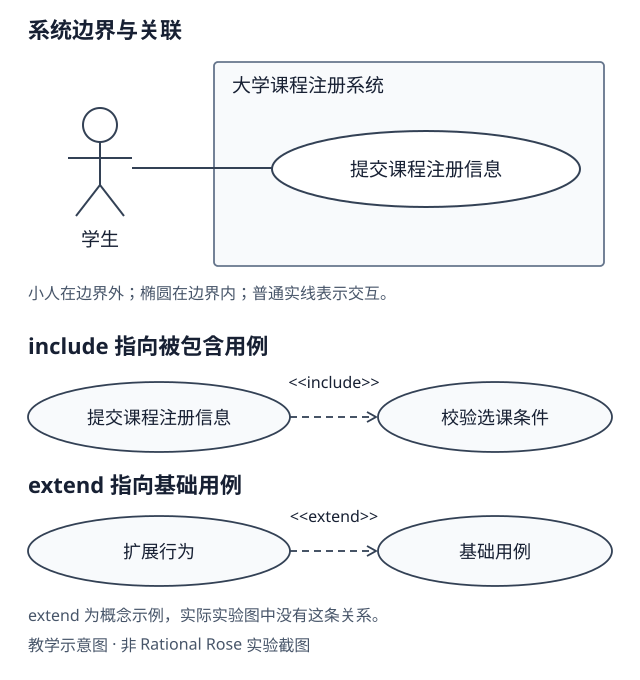
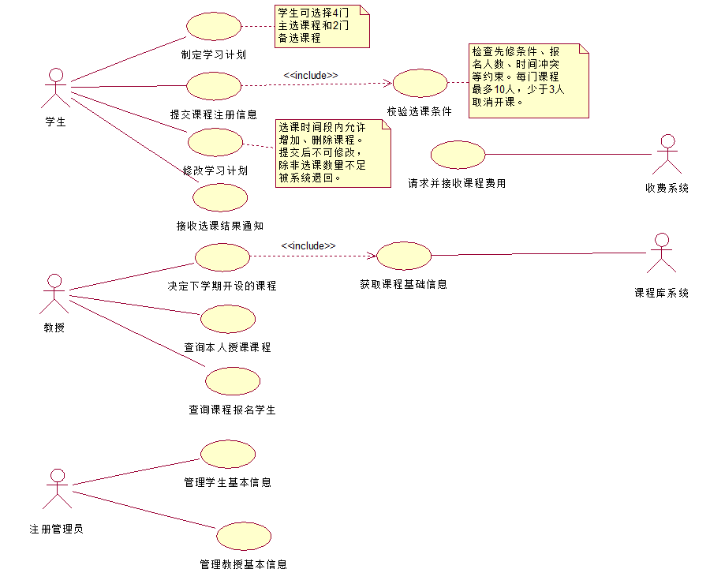

第一次做 UML 实验时，我连图里的小人、椭圆和虚线分别表示什么都不清楚。打开 Rational Rose，看到模板和一排绘图工具，也不知道该从哪里开始。

这次课程实验要求在 2 学时内，根据“大学课程注册系统”的需求确定参与者、提取用例、绘制用例图，再选一个用例写出描述。我最后保存了 `.mdl` 工程和截图，但过程中最有价值的部分，是弄清楚了几个问题：为什么收费系统也画成小人？哪些需求应该变成椭圆？为什么不能顺手加一个“查看课程”？

下面按从读需求到完成模型的顺序，把这些问题和实际操作放在一起讲。

## 一、UML 是什么

**UML（Unified Modeling Language，统一建模语言）**是一种描述系统结构和行为的建模语言。Rational Rose 是用来建立 UML 模型的软件。

常见的 UML 图如下，英文名称方便对照软件中的术语：

| UML 图类型                        | 主要作用                         |
| --------------------------------- | -------------------------------- |
| 用例图（Use Case Diagram）        | 谁能使用系统的哪些功能           |
| 类图（Class Diagram）             | 系统有哪些类，以及类之间的关系   |
| 时序图（Sequence Diagram）        | 各个对象如何交互，按什么顺序交互 |
| 活动图（Activity Diagram）        | 某个业务流程如何执行             |
| 状态机图（State Machine Diagram） | 对象在不同条件下如何改变状态     |

这次实验使用**用例图（Use Case Diagram）**，重点是“谁使用什么功能”，不表示业务的执行顺序。

## 二、实验原始需求

下面是实验指导书中的原文，关键内容已加粗。

需求：某个中等规模的大学为全日制的学生提供大量本科生学位，这个大学的教学机构由学院组成，每个学院包含几个专业方向。每个学院管理一种学位，每种学位都有若干必修课和若干选修课。每门课程都处于一个给定的级别，并且有一个学分值。同一门课程可以是若干学位的一部分，一个学位还含有其他学院提供的课程。每种学位都要给定完成学位所要求的总学分值。

每个学期末大学的**教授就要决定下个学期计划开设的课程**。所以教授决定开设的课程的汇总，形成下个学期将要开设的课程计划。课程的名称，编号，学分，先决条件等**课程信息全部来自课程库系统**。该课程库系统是该大学生已有的系统，**不列为本次项目的开发内容**。

令该大学自豪的是，其给予了学生在选课时的自主权。选课的灵活性使得大学课程注册系统变得复杂。**学生可以组合课程计划表所提供的课程，形成他们的学习计划（注册课程）**，一方面适合他们的客人需求，另一方面完成了这些课程他们就能得到他们所注册的学位。个人选课的自主权不应该与学位管理的规则相互矛盾，例如，**学生必须学习过某门课程的先修课程，才能选修该门课程**。学生对课程的选择可能受到**时间冲突，最大的班级人数**等条件限制。

在每个学期的开始，**学生们会得到一份本学期将要开设的课程计划表**。每门课程包含的信息有课程名称，课程编号，开课的教授，学院，选择该课程的先决条件，课程学分，已选学生人数等，可以帮助学生有目的地选择课程。新系统允许学生在将要来临的学期中选择**四门主选课程**。如果一门主选课程名额满员或被取消，**每个学生有重选的机会**。因此，新系统也允许学生选择**两门备选课程**。**每门课程最多有10名，最少3名学生选择才能开课**。**少于3个人报名的课程将被取消**。当一个学生的课程注册信息提交 之后，**系统检查他们的前提条件，所选课程 已经报名人数，时间表冲突等约束**，**将选课成功或失败的消息通知给学生**。

一旦学生**成功选中的课程门数少于计划时**，**系统重新开放该学生的学习计划修改权限**，允许该学生**保留成功选择的课程**，重新调整其余的课程。当一个学生的**课程注册信息最终完成之后**，**系统给收费系统发送一个消息**，**收费系统统计该学生已选课程的费用，再传回新系统**，以便学生为其中的课程付费。该收费系统是该对象已有的系统，**不列为本次项目的开发内容**。每个学期开学初有一段时间可以让学生改变学习计划，在这段时间内**学生可以增加或删除课程**，**一旦学生提交了学习计划，就不能再改变学习计划**，**除非因为选中课程的门数不达标而被系统退回**的情况。**选课时间段结束后，教授可以查询到他自己将要讲授的哪些课程以及这些课程中每门课程有哪些学生报名**。

当然了，为了适应每年新增的教授和学生，离职的教授和毕业的学生，新系统应当有效管理教授和学生的基本信息。**管理工作包括增加，修改，删除，查找**。**注册管理员负责管理教授和学生的基本信息**。

由于这个大学课程注册系统有其自身的独特性，找不到合适的商品软件，因而只能自行开发。

根据上述需求，完成以下任务：**（1）确定系统的参与者**；**（2）确定系统的用例**；**（3）细化用例，并创建用例图**；**（4）任选一个用例，给出它的用例描述**。

## 三、确定 Actor：为什么外部系统也是小人

Actor 通常译为“参与者”。判断一个对象是不是 Actor，关键是：**它是否在当前建模对象之外，以某种角色与这个系统交互？**

本次系统的参与者共有 5 个：

| 参与者     | 与大学课程注册系统的交互                 |
| ---------- | ---------------------------------------- |
| 学生       | 制定、提交和修改学习计划，接收选课结果   |
| 教授       | 决定开课课程，查询本人授课课程及报名学生 |
| 注册管理员 | 维护学生和教授的基本信息                 |
| 课程库系统 | 向注册系统提供课程基础信息               |
| 收费系统   | 接收最终选课信息，计算并返回费用         |

我最初困惑的是：后两个明明是软件，为什么也画成小人？

因为小人只是 Actor 的一种图形表示，并没有规定它必须是自然人。已有课程库和收费系统都在本次注册系统的开发范围之外，而且会交换数据，所以可以作为 Actor。[OMG 对 Actor 的说明](https://issues.omg.org/issues/UML25-417)强调的也是外部交互角色。

反过来，“学院”“学位”“课程”虽然出现在需求中，却没有在这里被描述为独立与系统交互的外部角色。它们更适合在领域分析、类图或规则说明中继续展开。

### 系统边界先是一项范围决定

系统边界表示本次建模对象负责的范围。画出边界矩形时，用例放在里面，Actor 放在外面。例如收费系统在大学内部，但相对于“本次开发的课程注册系统”，仍然属于外部。

下面是为讲解重新绘制的局部示意，**不是 Rational Rose 最终截图**。上半部分只展示少量元素，下面比较两种用例关系的箭头方向。



我的最终图没有画系统边界矩形。矩形有助于直观表达范围，但不是每张用例图都必须显示；OMG 的相关表示法使用的是“可以显示”的表述，见[系统边界表示法说明](https://issues.omg.org/issues/UML25-491)。不画矩形，也仍然需要在分析中把范围讲清楚。

## 四、提取 Use Case：椭圆不是操作步骤清单

Use Case 是“用例”，表示系统提供的一组行为，产生对参与者或其他利益相关者有价值的可观察结果。例如“提交课程注册信息”，结果是得到课程注册的处理结果。

椭圆是用例的表示法。它不意味着每次点击、每个字段、每条判断都要独立画出来。“点击提交按钮”“读取课程编号”“比较人数”通常可以作为用例内部的步骤。

这次最终保留了 12 个用例：

| 分组                 | 用例                                                           |
| -------------------- | -------------------------------------------------------------- |
| 学生相关             | 制定学习计划、提交课程注册信息、修改学习计划、接收选课结果通知 |
| 教授相关             | 决定下学期开设的课程、查询本人授课课程、查询课程报名学生       |
| 管理员相关           | 管理学生基本信息、管理教授基本信息                             |
| 外部系统交互         | 获取课程基础信息、请求并接收课程费用                           |
| 提交过程中的细化行为 | 校验选课条件                                                   |

“校验选课条件”没有单独连一个学生 Actor，它是提交用例中抽出的被包含行为。并不是每个椭圆都必须与 Actor 直接连线。

### 为什么最后没有添加“学生查看课程”

讨论时，我曾把“查看开课计划”作为候选用例。回头看原文，它说的是：

> 在每个学期的开始，学生们会得到一份本学期将要开设的课程计划表。

这说明学生会获得计划表，却没有直接规定必须在新系统里主动执行“查看课程”操作。它可以由系统页面提供，也可能通过其他方式发放；仅凭这句话无法确定交付方式。

所以本次模型没有保留这个独立椭圆。这不代表“查看课程”永远不能成为用例，而是如果要加，需要先说明“通过注册系统查询开课计划”这一推导前提，并与需求方确认。

同样，原文只明确了向收费系统请求费用和接收费用，没有展开新系统内的在线支付流程。因此最终模型中也没有添加“在线支付课程费用”。

这两次取舍让我意识到：候选功能可以提出，但不能把自己的设想写成题目已经规定的事实。

## 五、连线时分清关联、include 和 extend

### Association 表示交互

学生与“提交课程注册信息”之间的普通实线表示 Association，也就是关联：学生参与这个用例，与系统发生交互。

它不表示“第一步先学生，第二步再提交”，也不是泛化。用例图中元素的上下位置、关联线的排列，都不能当作业务执行顺序。

### include 指向被包含的行为

如果一个用例需要包含另一个用例的行为，可以使用 `<<include>>`。本次提交注册信息时，必须检查选课条件，因此画成：

```text
提交课程注册信息 --虚线箭头--> 校验选课条件
                  <<include>>
```

箭头指向被包含的用例。在这个案例中，提交不能跳过校验；但这不是说 UML 要把每个内部步骤都抽成一个用例，也不是说 include 一定对应程序里的函数调用。

另一条实际绘制的关系是：

```text
决定下学期开设的课程 --虚线箭头--> 获取课程基础信息
                      <<include>>
```

**课程资料来自课程库是原始需求；把获取资料抽成用例，并用 include 连接，是本次的建模决定。** 题目没有直接要求必须这样画。可以把资料获取留在开课用例的文字流程里，但本次选择显式画出与外部课程库的协作。

### extend 指向被扩展的基础用例

`<<extend>>` 表示向基础用例增加扩展行为，在满足相应条件、到达扩展点时插入；基础用例本身应能独立说明自己的行为。箭头从扩展用例指向被扩展的基础用例，方向与“从基础用例指向被包含行为”的 include 不同。

“选课数量不足后允许重新调整”有条件性，但**有条件不等于必须使用 extend**。若要把它建成扩展关系，还需要说明扩展的是哪个基础用例、在哪里扩展，以及条件是什么。也可以先把它写成提交用例的异常流程。

本次采用后者：**最终图只有两条 include，没有 extend。** [OMG 对 Extend 的说明](https://issues.omg.org/issues/UML25-418)可以帮助理解条件性扩展，而不必为了凑齐关系类型往图上加线。

| 关系           | 表达什么                             | 箭头或连线                   |
| -------------- | ------------------------------------ | ---------------------------- |
| Association    | Actor 与用例存在交互                 | 本次使用普通实线             |
| include        | 包含另一用例的行为                   | 虚线开放箭头，指向被包含用例 |
| extend         | 在扩展点加入额外行为                 | 虚线开放箭头，指向基础用例   |
| Generalization | 特殊角色或用例是一般角色或用例的一种 | 实线空心三角箭头，指向一般者 |

泛化适合表达“一种”的关系，例如在确实存在角色继承需求时，某种特殊学生角色可以是学生角色的一种。本次没有这样的明确需求，所以没有绘制泛化关系。

### 虚线并不自动等于 include

UML 中，依赖等其他关系也可能用虚线箭头表示。要同时看端点、箭头、关系类型以及 `<<include>>`、`<<extend>>` 等标记，不能只看线是不是虚的。

Note 的连接线又是另一回事：它只是把注释附在元素上，不表示 Actor 参与用例，也不表示包含或扩展。

## 六、在 Rational Rose 中把分析落实为模型

下面记录的是这次课堂使用的经典版本界面。不同版本的工具栏名称和位置可能不同，判断时应以工具提示、关系属性和生成的图为准。

### 创建工程和用例图

启动后会出现 **Create New Model** 对话框，列出 J2EE、J2SE 等模板。本实验不涉及代码生成，我关闭了模板选择窗口，进入默认模型。

接着展开左侧 **Use Case View**，右键新建 **Use Case Diagram**，命名为“大学课程注册系统”，双击打开绘图区域。这里要区分模型树和当前图：工程可以有多张图，画布只是其中一张。

我先放置 5 个 Actor，再按学生、教授、管理员分组放置用例，把课程库和收费系统放在右侧。Actor 用小人工具，Use Case 用椭圆工具。这个排列只是为了减少交叉线，不表示流程顺序。

### 给参与者和用例画关联

我当时在工具栏里看到了 **Generalization**、**Unidirectional Association** 等选项，和其他教程的截图不完全一样，一度以为它们都可以当普通连线使用。

这里应该寻找 Association 对应的关联工具，并检查关系属性。如果使用的是带方向的关联工具，还要检查端点的可导航设置，确认是否符合想表达的关系；不要用 Generalization 代替实线关联。

操作上，从一个元素拖到另一个元素建立连接。Rose 不一定像 draw.io 那样有明显的吸附反馈。我会切回选择工具，稍微移动元素，观察关系线是否仍跟随端点，避免只画出了一条看起来贴近元素的线。

### 建立本次的 include 关系

我实际使用的工具提示叫 **Dependency or instantiates**，图标是斜向虚线箭头。操作顺序是：

1. 从“提交课程注册信息”拖到“校验选课条件”。
2. 打开这条关系的 **Specification**。
3. 把 **Stereotype** 设置为 `include`。
4. 检查图上是否显示 `<<include>>`，箭头是否指向校验用例。
5. 用同样方式连接“决定下学期开设的课程”与“获取课程基础信息”。

这是该经典 Rose 环境的操作方式。本次 `.mdl` 的确把这两条关系保存成带 `include` 标记的 `Dependency_Relationship`。现代 UML 中 Include 是专门的模型关系，不能认为在任意工具里给普通依赖改一个标签，就一定创建了正确的 Include 元素。更换工具或导入模型后，需要重新核对关系语义。

### 用 Note 保留业务规则

我没有把“最多 10 人”单独画成 Actor 或用例，而是用 Note 加了三组注释：

- 连到“制定学习计划”：4 门主选课程和 2 门备选课程。
- 连到“校验选课条件”：先修条件、报名人数、时间冲突，以及最多 10 人、少于 3 人取消开课。
- 连到“修改学习计划”：选课期间可增删，提交后锁定，选课不足退回时可修改。

这些注释让图保持简洁。不过第二组把几个约束放在一起，并不说明它们全都在同一时刻执行；人数下限的处理时机，还要在用例描述中展开。

### 重新打开后，为什么以为内容丢了

保存 `.mdl` 后再次打开，我曾遇到画布空白、以为没有保存成功的情况。实际应先检查：

1. 展开 **Use Case View**。
2. 找到自己命名的“大学课程注册系统”图。
3. 双击这张图，而不是只看默认 **Main** 图。

本次工程中同时存在 `Main` 和“大学课程注册系统”两张用例图。打开空白 Main，并不代表其他图也为空。当然，这只是本次情况的排查经验；不能把所有空白工程都归结为打开了错误的图。

## 七、最终成果，以及图里没有表达的内容

下面是本次实验的 **Rational Rose 原始截图**，没有用其他工具重画替代。



_图：大学课程注册系统的最终用例图，可点击放大。_

对照工程文本与截图，可以确认最终模型包含前面的 5 个参与者、12 个用例、2 条 include 和 3 组注释；没有“查看课程”“在线支付”用例，没有 extend，也没有显示系统边界矩形。

这张图表达了业务范围和主要交互，但不包含所有细节。例如：

- “请求并接收课程费用”与收费系统相连，但何时发送请求，要由文字说明“课程注册最终完成后”。
- “管理学生基本信息”“管理教授基本信息”各自概括增加、修改、删除和查找，没有拆成 8 个椭圆。
- 备选课程如何确认、是否自动替换，题目没有明确规定，不能把某种算法写成已经实现的功能。

因此，完成用例图之后，还需要用例描述把关键流程补齐。

## 八、为“提交课程注册信息”写一份用例描述

这份描述按题目整理，不预设数据库表、消息队列、自动补选算法或支付渠道。

### 目标与条件

- **用例名称**：提交课程注册信息。
- **用例目标**：提交学习计划，经校验形成课程注册结果，并让学生知道处理情况。
- **主要参与者**：学生。
- **前置条件**：当前处于允许选课的时间段；已有本学期开课计划；学生已准备好学习计划，且当前计划允许提交或重新提交。
- **触发条件**：学生确认课程选择并提交注册信息。

### 基本流程

1. 学生提交学习计划中的课程选择，包括主选课程及所选备选课程。
2. 系统执行“校验选课条件”，检查课程的先修要求、名额上限、时间冲突等约束。
3. 系统记录符合条件的注册结果，并向学生通知成功或失败的消息。
4. 若成功选中的课程达到计划数量，则该次提交后的计划不再允许任意修改；若不足，进入下述调整流程。

课程是否因不足 3 人而取消，需要在确定开课结果时进一步处理。**课程注册最终完成后**，系统才向收费系统发送最终选课信息，接收计算后的费用；不能在每次尝试提交时，都假定已完成最终计费。

### 备选和异常流程

| 情况              | 处理                                                           |
| ----------------- | -------------------------------------------------------------- |
| 先修条件不满足    | 该课程不能注册成功，向学生说明原因                             |
| 课程满员          | 该主选课程不能注册成功，学生有使用备选或重选的机会             |
| 课程时间冲突      | 反馈冲突情况，由学生调整课程选择                               |
| 最终报名不足 3 人 | 取消该课程；若影响学生的计划门数，转入选课不足处理             |
| 成功选课数量不足  | 保留成功课程，退回学习计划并重新开放修改权限，学生调整后再提交 |

备选课程同样受约束。原文允许选择备选课程，但没有规定系统必须自动、按某种固定顺序替换主选，因此这里保留为重选机会，不擅自确定实现方式。

### 后置条件和业务规则

成功课程的注册结果被保留，学生收到结果；不足的计划被退回，允许在选课时间段内继续调整。最终注册完成后，系统请求并接收费用信息。

业务规则包括：4 门主选、可选 2 门备选；课程上限 10 人、最低开课人数 3 人；满足先修和学位规则；避免时间冲突；提交后锁定，因不足被退回时例外开放修改。

这段文字补上的是图中看不出来的条件和处理顺序。如果还要详细表达分支，可以继续画活动图；如果要展示注册系统与收费系统的消息顺序，则可以另画时序图。

## 九、工具怎么选：先看课堂要求和维护方式

这次用 Rational Rose，是为了跟随课堂环境。其他工具也可以表达同样的用例概念，但操作方式和文件格式不同。

| 工具                                                                        | 主要方式                                | 使用时的考虑                                |
| --------------------------------------------------------------------------- | --------------------------------------- | ------------------------------------------- |
| IBM Rational Rose                                                           | 经典图形化 UML 建模，模型树配合图形工具 | 适合跟随本次课堂环境，保留原始模型工程      |
| [PlantUML](https://plantuml.com/use-case-diagram)                           | 用文本描述参与者、用例和关系，再生成图  | 文本便于 Git 比较和程序化维护，需要学习语法 |
| [draw.io](https://www.drawio.com/docs/diagram-types/uml/use-case-diagrams/) | 通用图形编辑器，使用 UML 图形库拖拽绘图 | 调整布局方便，需要自己核对 UML 语义         |
| [Visual Paradigm](https://www.visual-paradigm.com/features/uml-tool/)       | 支持多类 UML 图及模型元素管理           | 适合需要持续维护多个相关模型的场景          |

例如，使用 PlantUML 可以这样表达提交与校验的局部关系：

```text
@startuml
left to right direction
actor 学生 as Student
rectangle 大学课程注册系统 {
  usecase 提交课程注册信息 as Submit
  usecase 校验选课条件 as Validate
  Submit .> Validate : <<include>>
}
Student -- Submit
@enduml
```

这只是另一种写法的教学示例，**不是本次 Rose 工程的导出结果**。博客中显示的是源代码，实际生成图需要交给 PlantUML。

`.mdl` 是本次 Rose 的模型工程文件，`.puml` 通常保存 PlantUML 文本，二者不能靠修改扩展名互相转换，也不能假定不同工具的工程文件可以直接互相编辑。

## 十、下次建模时，我会先检查什么

这次花时间最多的地方，是把需求里的事实、业务规则和自己的推导分开。下次再读一份需求，我会先检查这几件事：

- 系统负责到哪里，哪些系统已经存在？
- 每个 Actor 是否真的以外部角色参与交互？
- 每个用例是否表达了有意义的行为，而不是把每次点击都画出来？
- 每条 include 或 extend 是否有语义依据，方向是否正确？
- 课程数量、名额和修改权限等规则，是否在合适的位置说明了处理条件和时机？

“查看课程”被移出最终模型，是这次最值得记住的修正。一个功能看起来合理，和题目已经要求它，是两件需要分别说明的事。把这个边界想清楚，图和后面的文字描述才更容易保持一致。

## 参考资料

- 本次课程资料《实验一 用例图的设计与制作》、本人绘制的 Rational Rose `.mdl` 工程及最终截图。
- [OMG UML 2.5.1 规范入口](https://www.omg.org/spec/UML/2.5.1)，用例相关概念见第 18 章。本文用现代 UML 术语解释概念，经典 Rose 中的具体保存形式可能不同。
- [IBM 对 Rose 模型导入和 UML 2 语义映射的说明](https://www.ibm.com/docs/en/rsas/7.5.0?topic=mapping-rational-rose-specific-uml-20-semantic)，用于理解工具迁移时为何仍需核对模型关系。
- [PlantUML 用例图语法](https://plantuml.com/use-case-diagram)、[draw.io 用例图文档](https://www.drawio.com/docs/diagram-types/uml/use-case-diagrams/)与 [Visual Paradigm UML 工具说明](https://www.visual-paradigm.com/features/uml-tool/)。
